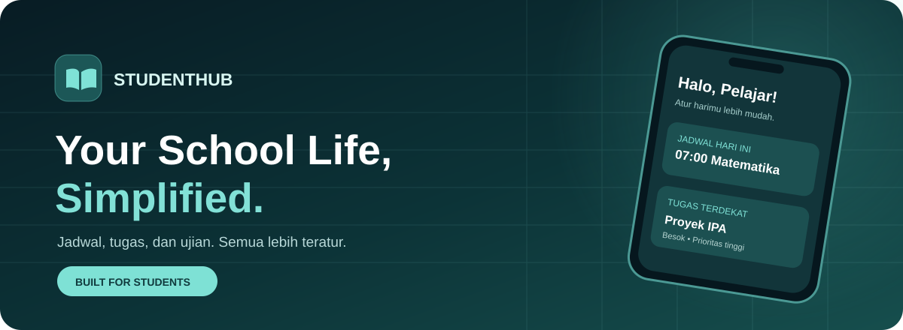
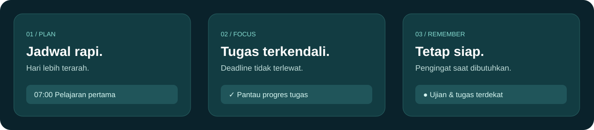

 

### Sekolah lebih teratur. Hari-hari lebih ringan.

**StudentHub** adalah aplikasi Android untuk pelajar yang ingin mengatur jadwal, tugas, dan ujian dalam satu tempat yang nyaman digunakan.

 

 

### [⬇️ LIHAT BUILD & DOWNLOAD APK](https://github.com/kuroziitamvan/studenthub-kurozi/actions/workflows/build-android.yml) · [🌐 COBA VERSI WEB](https://studenthub-kurozi.lovable.app)

APK saat ini tersedia melalui GitHub Actions sebagai build pengembangan (debug). Login GitHub mungkin diperlukan untuk mengunduh artifact. Belum ada APK rilis publik yang diunggah ke repository ini.

---

## ✦ Meet StudentHub

> **Bukan cuma daftar tugas. Ini ruang kecil untuk membuat kehidupan sekolah terasa lebih terkendali.**

Pernah lupa tugas yang deadline-nya besok? Bingung pelajaran pertama hari ini? Atau harus membuka banyak catatan cuma untuk mencari jadwal ujian?

StudentHub menyatukan semuanya dalam satu pengalaman yang sederhana. Dibangun untuk pelajar Indonesia, dengan antarmuka yang nyaman, navigasi praktis, dan fitur yang fokus pada hal yang benar-benar dibutuhkan.

## Fitur unggulan

| | Fitur | Apa yang bisa kamu lakukan? |
|:--:|---|---|
| 📅 | **Jadwal Pelajaran** | Simpan mata pelajaran, jam belajar, ruang, dan guru. |
| ✅ | **Manajemen Tugas** | Catat tugas, tentukan prioritas, pantau status, dan deadline. |
| 📝 | **Agenda Ujian** | Susun jadwal ujian agar persiapan tidak mendadak. |
| 🔔 | **Pengingat Android** | Pengingat tugas, ujian, dan jadwal melalui sistem notifikasi perangkat.* |
| 🧩 | **Widget Homescreen** | Lihat ringkasan jadwal hari ini dan tugas terdekat langsung dari layar utama.* |
| 🌗 | **Tampilan Nyaman** | Desain modern dengan dukungan tema yang nyaman dilihat. |
| 📱 | **Web & Android** | Akses StudentHub dari browser atau aplikasi Android. |

*Fitur Android masih dalam pengembangan dan perlu pengujian pada berbagai perangkat. Pengingat tidak dijamin muncul tepat pada menit tertentu; data widget disinkronkan setelah aplikasi dibuka.

## ✦ Designed for everyday school life

### Alur yang simpel

**01 — Rencanakan.** Masukkan jadwal pelajaran, ujian, dan tugasmu.

**02 — Pantau.** Lihat apa yang perlu dikerjakan lebih dulu.

**03 — Fokus.** Gunakan ringkasan dan pengingat agar aktivitas sekolah lebih terarah.

---

## Download & instalasi

> [!IMPORTANT]
> **Belum tersedia file APK publik di bagian Releases repository ini.** Untuk sementara, APK pengembangan ada pada artifact GitHub Actions repository aplikasi. Jangan mengunduh APK dari tautan pihak ketiga yang tidak dikenal.

1. Buka **[StudentHub Android Builds](https://github.com/kuroziitamvan/studenthub-kurozi/actions/workflows/build-android.yml)**.
2. Pilih workflow **Build StudentHub APK** terbaru dengan status **hijau**.
3. Di bagian **Artifacts**, unduh **StudentHub-debug-apk** (login GitHub mungkin diperlukan).
4. Ekstrak file ZIP, lalu instal **app-debug.apk** di Android.
5. Buka StudentHub dan izinkan notifikasi jika ingin menggunakan fitur pengingat.

**Penting:** APK debug bukan rilis stabil. Jika perangkat meminta izin pemasangan dari sumber tersebut, pastikan file berasal dari workflow resmi. Perbedaan tanda tangan APK bisa membuat pembaruan gagal; cadangkan data sebelum menghapus instalasi lama.

**Lebih suka tanpa instalasi?** [Gunakan StudentHub di browser →](https://studenthub-kurozi.lovable.app)

---

## FAQ

<b>Apakah StudentHub gratis?</b>

 
StudentHub dapat dicoba melalui website publik. Build Android pengembangan juga tersedia melalui GitHub Actions.

<b>Kenapa APK belum ada di Releases?</b>

 
Distribusi rilis publik masih dipersiapkan. Artifact Actions merupakan hasil build pengembangan dan tidak sama dengan APK rilis resmi.

<b>Apakah notifikasi tetap berjalan saat aplikasi ditutup?</b>

 
Versi Android menggunakan pemeriksaan berkala di latar belakang berdasarkan data yang terakhir tersinkron. Android dapat menunda proses karena penghematan baterai; waktunya tidak selalu tepat.

<b>Kenapa widget belum menampilkan tugas terbaru?</b>

 
Buka aplikasi StudentHub terlebih dahulu untuk mengirim data terbaru ke widget. Pastikan APK yang dipasang merupakan build terbaru yang berhasil.

<b>Apakah tersedia untuk iPhone?</b>

 
Saat ini APK ditujukan untuk Android. Pengguna iPhone dapat mencoba versi web melalui browser.

---

## Pembaruan & roadmap

- [x] Aplikasi berbasis web
- [x] Build APK Android melalui GitHub Actions
- [x] Fondasi widget dan pengingat Android
- [ ] Pengujian menyeluruh di berbagai perangkat
- [ ] APK rilis publik yang mudah diunduh
- [ ] Distribusi pembaruan yang lebih praktis

> Fitur dan tampilan dapat berubah selama pengembangan.

## Contact & collaboration

Punya masukan, menemukan bug, atau ingin membahas kerja sama?

### Let's build something better.

**Business contact:** [@jerpiey](https://t.me/jerpiey)

Untuk pertanyaan bisnis, kolaborasi, dan masukan terkait StudentHub.

---

**StudentHub** · *Your School Life, Simplified.*

Made for students, with care. ✦

